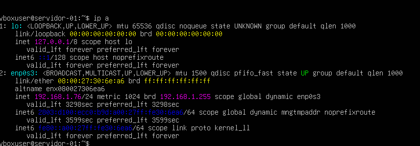
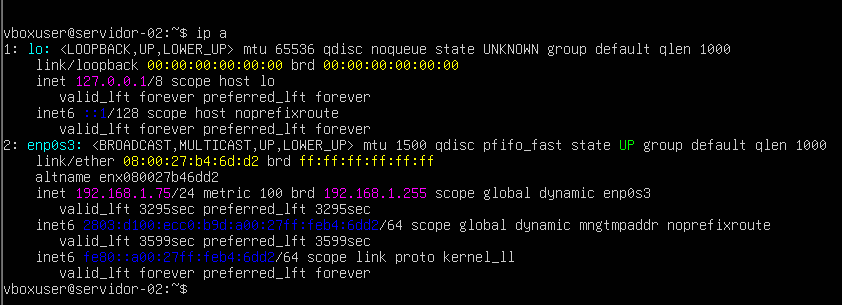

# Tarea 02 - Comunicacion entre Servidores Virtuales (Guest to Guest)

**Curso:** Virtualizacion  
**Rama:** `hw-02`  
**Estudiante:** Christian Villegas
---

## Descripcion
Configuracion de dos maquinas virtuales (Ubuntu Server) con adaptadores de red en modo **Puente (Bridged)** para que pertenezcan a la misma subred local. Se configuro el nombre de host de ambas maquinas y se comprobo la conectividad bidireccional mediante el protocolo ICMP.

---

## Configuracion de Hosts e IPs

### Servidor Virtual 1
- **Hostname:** `servidor-01`
- **Direccion IP:** `192.168.1.76`

### Servidor Virtual 2
- **Hostname:** `servidor-02`
- **Direccion IP:** ` 192.168.1.75`

---

## Prueba de Conectividad (Ping)

Se realizo un `ping` exitoso desde el Servidor 1 hacia el Servidor 2, validando la comunicacion en la misma subred.

