# virtualizacion-tareas
Tareas del curso de virtualizacion

## Personal Project 01 - Monitoreo y logs (Prometheus, Loki, Promtail y Grafana)

Instalar un stack de monitoreo y centralizacion de logs en el cluster de Minikube de las actividades anteriores (MetalLB + Traefik + las 4 apps de `parcial-cavv`) y exponer Grafana y Prometheus por Traefik con nombre de dominio.

### Flujo

```
Metricas: kubelet/cAdvisor, node-exporter, kube-state-metrics, Traefik, MetalLB... <- Prometheus (scrape cada 30s)
Logs:     contenedores -> /var/log/pods del nodo -> Promtail (DaemonSet) -> Loki
Grafana:  data sources Prometheus + Loki (provisioning) -> dashboards (JSON en el repo)
Acceso:   navegador -> hosts -> Traefik (LoadBalancer de MetalLB) -> Ingress grafana/prometheus.cavv.dominio
```

### Estructura

```
k8s/
├── 01-metallb/metallb-config.yaml            # del assessment 02
├── 02-traefik/traefik.yaml                   # del assessment 02 + metricas de Prometheus
├── 03-apps/                                  # las 4 apps de parcial-cavv
│   ├── 00-namespace.yaml
│   ├── nginx.yaml
│   ├── whoami.yaml                           # + --verbose (loguea cada peticion)
│   ├── podinfo.yaml                          # + PODINFO_LEVEL=debug (loguea cada peticion)
│   └── juego2048.yaml                        # + logs de nginx a stdout
└── 04-monitoring/                            # stack de monitoreo (namespace monitoring-cavv)
    ├── 00-namespace.yaml
    ├── prometheus/values.yaml                # chart prometheus-community/prometheus
    ├── loki/values.yaml                      # chart grafana-community/loki
    ├── promtail/values.yaml                  # chart grafana/promtail
    ├── grafana/
    │   ├── values.yaml                       # chart grafana-community/grafana (data sources y provider de dashboards)
    │   └── dashboards/
    │       ├── kustomization.yaml            # genera el ConfigMap con los JSON
    │       ├── cluster-metricas.json         # dashboard de CPU, memoria y estado de pods
    │       └── logs-parcial-cavv.json        # dashboard de logs de las 4 apps
    ├── metallb-metrics-rbac.yaml             # permisos para que MetalLB deje leer sus metricas
    └── ingress.yaml                          # grafana.cavv.dominio y prometheus.cavv.dominio
capturas/
```

### Namespaces

| Namespace | Contenido |
|---|---|
| `metallb-system` | MetalLB |
| `traefik` | Traefik |
| `parcial-cavv` | Las 4 aplicaciones |
| `argocd-cavv` | Argo CD (assessment 06) |
| `monitoring-cavv` | Prometheus, Loki, Promtail y Grafana (`monitoring-` + mis iniciales) |

### Versiones

| Componente | Chart | Version del chart | Version de la app |
|---|---|---|---|
| Prometheus (+ kube-state-metrics y node-exporter) | `prometheus-community/prometheus` | 29.37.1 | v3.15.1 |
| Loki | `grafana-community/loki` | 19.0.3 | 3.7.9 |
| Promtail | `grafana/promtail` | 6.17.1 | 3.5.1 |
| Grafana | `grafana-community/grafana` | 14.0.1 | 13.2.4 |

Los charts de Loki y Grafana ahora se publican en el repo `grafana-community`. Promtail sigue en el repo `grafana` (esta marcado como deprecated porque Grafana lo reemplazo por Alloy, pero funciona y es lo que pide la actividad).

### Requisitos

- Minikube corriendo con MetalLB, Traefik y las apps del assessment 02 (Traefik con la IP `192.168.49.200`)
- kubectl y Helm (yo instale Helm con `winget install Helm.Helm`)

Si se parte de un cluster vacio:

```bash
kubectl apply -f https://raw.githubusercontent.com/metallb/metallb/v0.16.1/config/manifests/metallb-native.yaml
kubectl wait -n metallb-system --for=condition=ready pod --all --timeout=120s
kubectl apply -f k8s/01-metallb/metallb-config.yaml
kubectl apply -f k8s/02-traefik/traefik.yaml
kubectl apply -f k8s/03-apps/
```

Repos de Helm:

```bash
helm repo add prometheus-community https://prometheus-community.github.io/helm-charts
helm repo add grafana https://grafana.github.io/helm-charts
helm repo add grafana-community https://grafana-community.github.io/helm-charts
helm repo update
```

### Instalacion rapida (todo junto)

```bash
kubectl apply -f k8s/02-traefik/traefik.yaml
kubectl apply -f k8s/04-monitoring/00-namespace.yaml
kubectl apply -f k8s/04-monitoring/metallb-metrics-rbac.yaml
kubectl apply -k k8s/04-monitoring/grafana/dashboards

helm upgrade --install prometheus prometheus-community/prometheus --version 29.37.1 -n monitoring-cavv -f k8s/04-monitoring/prometheus/values.yaml
helm upgrade --install loki grafana-community/loki --version 19.0.3 -n monitoring-cavv -f k8s/04-monitoring/loki/values.yaml
helm upgrade --install promtail grafana/promtail --version 6.17.1 -n monitoring-cavv -f k8s/04-monitoring/promtail/values.yaml
helm upgrade --install grafana grafana-community/grafana --version 14.0.1 -n monitoring-cavv -f k8s/04-monitoring/grafana/values.yaml

kubectl apply -f k8s/04-monitoring/ingress.yaml
kubectl wait -n monitoring-cavv --for=condition=ready pod --all --timeout=300s
```

```bash
kubectl get pods -n monitoring-cavv
# grafana-...                            1/1   Running
# loki-0                                 1/1   Running
# prometheus-kube-state-metrics-...      1/1   Running
# prometheus-prometheus-node-exporter-.. 1/1   Running
# prometheus-server-...                  2/2   Running
# promtail-...                           1/1   Running
```

Abajo se explica cada parte.

---

## 1. Prometheus

`k8s/04-monitoring/prometheus/values.yaml`. El chart instala:

- **prometheus-server**: con un PVC de 4Gi, retencion de 7 dias y `scrape_interval` de 30s.
- **kube-state-metrics**: metricas del estado de los objetos de Kubernetes (fase de los pods, reinicios, nodos Ready...). De aqui sale el estado de los pods del dashboard.
- **node-exporter** (DaemonSet): CPU, memoria y disco del nodo.
- Alertmanager y Pushgateway se desactivaron porque no se usan.

Jobs de scrape que quedan configurados:

| Job | Que recolecta |
|---|---|
| `prometheus` | el propio Prometheus |
| `kubernetes-api-servers` | el API server |
| `kubernetes-nodes` | el kubelet |
| `kubernetes-nodes-cadvisor` | cAdvisor (CPU y memoria de cada contenedor) |
| `kubernetes-service-endpoints` | Services con la anotacion `prometheus.io/scrape` (kube-state-metrics, node-exporter, CoreDNS) |
| `kubernetes-pods` | Pods con la anotacion `prometheus.io/scrape` (Loki, Promtail y Grafana, que la tienen en sus values) |
| `traefik` | metricas de Traefik (job extra en `extraScrapeConfigs`) |
| `metallb` | controller y speaker de MetalLB (job extra, HTTPS con token) |

Cambios que hice fuera del chart para que todos los targets esten UP:

- **Traefik**: no exponia metricas. En `k8s/02-traefik/traefik.yaml` agregue `--metrics.prometheus=true`, asi publica `/metrics` en el puerto 8080 y el job `traefik` lo lee por el Service `traefik-dashboard`.
- **MetalLB**: sus pods tienen la anotacion `prometheus.io/scrape`, pero sirven `/metrics` por HTTPS y piden token, entonces en el job `kubernetes-pods` salian DOWN (`400 Bad Request`). Los saque de ese job (`pre_relabel_configs`) y les hice el job `metallb` con `scheme: https` y el token del ServiceAccount de Prometheus. Despues daba `500` porque MetalLB no tenia permiso para validar el token (`tokenreviews ... is forbidden` en sus logs); `metallb-metrics-rbac.yaml` le da permiso de crear `TokenReview` y `SubjectAccessReview`.

```bash
helm upgrade --install prometheus prometheus-community/prometheus --version 29.37.1 -n monitoring-cavv -f k8s/04-monitoring/prometheus/values.yaml
```

### Targets

Todos los targets en **Status > Target health** estan UP:

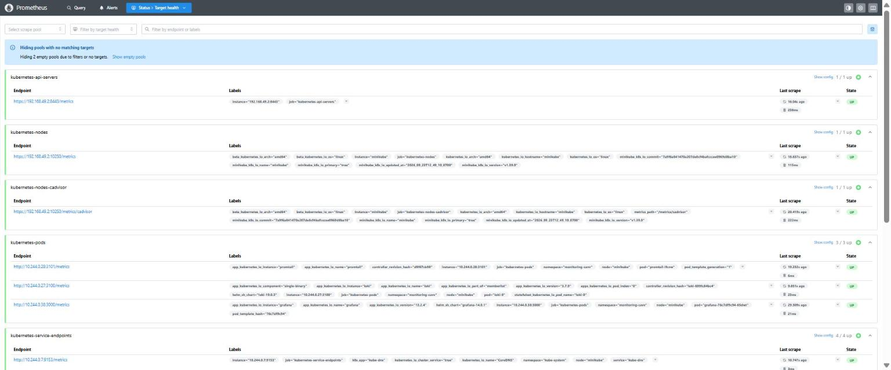

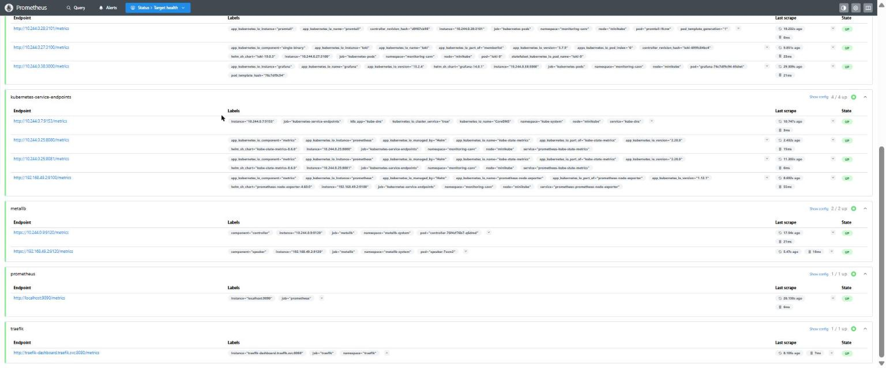

## 2. Loki

`k8s/04-monitoring/loki/values.yaml`:

- `deploymentMode: Monolithic`: un solo pod (`loki-0`) con todos los componentes, suficiente para minikube.
- `auth_enabled: false`: sin multi-tenant, asi Promtail y Grafana no tienen que mandar el header `X-Scope-OrgID`.
- Almacenamiento `filesystem` en un PVC de 4Gi, esquema `v13` con indice `tsdb`.
- Retencion de 7 dias (`retention_period: 168h`, la aplica el compactor).
- Se desactivaron el gateway (nginx), las caches de memcached, el canary, el ruler y los tests para ahorrar memoria. Promtail y Grafana se conectan directo al Service `loki:3100`.

```bash
helm upgrade --install loki grafana-community/loki --version 19.0.3 -n monitoring-cavv -f k8s/04-monitoring/loki/values.yaml
```

## 3. Promtail

`k8s/04-monitoring/promtail/values.yaml`. Corre como **DaemonSet** (un pod por nodo) y monta `/var/log/pods` del nodo, que es donde el kubelet guarda la salida de todos los contenedores.

Configuracion del job `kubernetes-pods`:

- `kubernetes_sd_configs` con `role: pod`: descubre todos los pods del cluster por la API de Kubernetes.
- `pipeline_stages: cri`: minikube usa containerd, los logs vienen en formato CRI (`fecha stream flag mensaje`) y este stage los separa.
- Etiquetas que se le ponen a cada linea:

| Etiqueta | De donde sale |
|---|---|
| `namespace` | namespace del pod |
| `app` | label `app` del pod (o `app.kubernetes.io/name`) -> `nginx`, `whoami`, `podinfo`, `juego2048`, `traefik`... |
| `pod`, `container`, `node_name` | nombre del pod, contenedor y nodo |
| `job` | `namespace/app` |

- `__path__`: arma la ruta del archivo `/var/log/pods/<ns>_<pod>_<uid>/<contenedor>/*.log`.
- `clients`: manda todo a `http://loki.monitoring-cavv.svc:3100/loki/api/v1/push`.

Se recolectan los logs de todo el cluster, incluidos los de las 4 apps de `parcial-cavv` y los de Traefik.

```bash
helm upgrade --install promtail grafana/promtail --version 6.17.1 -n monitoring-cavv -f k8s/04-monitoring/promtail/values.yaml
```

### Ajustes en las apps

- **juego2048**: la imagen escribe los logs de nginx en `/var/log/nginx/access.log` *dentro* del contenedor, no en stdout, entonces el kubelet no los ve y Promtail tampoco. En `k8s/03-apps/juego2048.yaml` cambie el arranque para hacer un symlink de esos archivos a `/dev/stdout` y `/dev/stderr` (lo mismo que hace la imagen oficial de nginx).
- **whoami**: solo escribia `Starting up on port 80`. Con `args: ["--verbose"]` escribe una linea por cada peticion.
- **podinfo**: en nivel `info` solo escribe al arrancar. Con la variable `PODINFO_LEVEL=debug` escribe `request started` por cada peticion.

Como estas apps las maneja Argo CD (assessment 06, con `selfHeal`), si las cambiaba con `kubectl` las regresaba a como estaban en la rama `assessment-06`. Cambie las 4 Application para que sigan esta rama y Argo CD aplico los cambios solo:

```bash
for a in nginx whoami podinfo juego2048; do
  kubectl patch application $a -n argocd-cavv --type merge -p '{"spec":{"source":{"targetRevision":"personal-project-01"}}}'
done
```

Verificar en Loki las apps que tienen logs:

```bash
kubectl get --raw "/api/v1/namespaces/monitoring-cavv/services/loki:3100/proxy/loki/api/v1/label/app/values"
# {"status":"success","data":[..., "juego2048", ..., "nginx", "podinfo", ..., "traefik", "whoami"]}
```

## 4. Grafana

`k8s/04-monitoring/grafana/values.yaml`. Todo se configura por **provisioning** (archivos que Grafana lee al arrancar), nada a mano desde la interfaz.

### Data sources como codigo

En `datasources` del values. El chart lo convierte en `/etc/grafana/provisioning/datasources/datasources.yaml`:

| Nombre | uid | Tipo | URL |
|---|---|---|---|
| Prometheus (default) | `prometheus` | prometheus | `http://prometheus-server.monitoring-cavv.svc` |
| Loki | `loki` | loki | `http://loki.monitoring-cavv.svc:3100` |

Tienen `editable: false`, en la interfaz salen como provisionados y no se pueden modificar. Los `uid` son fijos porque los dashboards los usan.

### Dashboards como codigo

- Los JSON estan en `k8s/04-monitoring/grafana/dashboards/`.
- `kustomization.yaml` los mete en el ConfigMap `grafana-dashboards-cavv` (`configMapGenerator`).
- En el values, `dashboardsConfigMaps` monta ese ConfigMap en `/var/lib/grafana/dashboards/cavv` y `dashboardProviders` le dice a Grafana que cargue los JSON de esa carpeta en el folder **Monitoreo CAVV**.

```bash
kubectl apply -k k8s/04-monitoring/grafana/dashboards
helm upgrade --install grafana grafana-community/grafana --version 14.0.1 -n monitoring-cavv -f k8s/04-monitoring/grafana/values.yaml
```

Si se cambia un JSON: `kubectl apply -k ...` y reiniciar Grafana (`kubectl rollout restart deploy/grafana -n monitoring-cavv`).

**Cluster - Metricas (CPU, memoria y pods)** (`cluster-metricas.json`, datos de Prometheus):

- Resumen: % de CPU y memoria del nodo (node-exporter), nodos Ready, pods Running, pods Pending/Failed/Unknown y reinicios de contenedores en la ultima hora.
- CPU y memoria por namespace (cAdvisor: `container_cpu_usage_seconds_total`, `container_memory_working_set_bytes`).
- CPU y memoria por pod del namespace elegido en la variable `namespace` (por defecto `parcial-cavv`).
- Estado de los pods: pods por fase y tabla con fase, contenedores listos y reinicios de cada pod (kube-state-metrics).

**Logs - Apps de parcial-cavv (Loki)** (`logs-parcial-cavv.json`, datos de Loki):

- Lineas de log por app (`count_over_time`) y total en el rango.
- Un panel de logs por cada app: `{namespace="parcial-cavv", app="nginx"}`, `whoami`, `podinfo` y `juego2048`.
- Panel con todas las apps juntas (filtrable con la variable `app`).
- Panel con el access log de Traefik, filtrado a las rutas de las apps (`|= "\"parcial-cavv-"`, el nombre del router que Traefik crea para cada Ingress de `parcial-cavv`).
- Variable `buscar` para filtrar las lineas por texto.

### Usuario

Usuario `admin`. La contrasena la genera el chart y queda en el Secret `grafana`:

```bash
kubectl get secret grafana -n monitoring-cavv -o jsonpath='{.data.admin-password}' | base64 -d
```

## 5. Exposicion por Traefik y DNS

`k8s/04-monitoring/ingress.yaml` tiene 2 Ingress con la clase `traefik`, igual que los de las apps. Use el mismo dominio que Argo CD en el assessment 06 (`<servicio>.cavv.dominio`):

| Dominio | Service |
|---|---|
| `grafana.cavv.dominio` | `grafana:80` |
| `prometheus.cavv.dominio` | `prometheus-server:80` |

Ademas, en los values se configuro la URL publica de cada uno (`root_url` en Grafana y `baseURL` en Prometheus) para que los links y redirecciones usen el dominio.

```bash
kubectl apply -f k8s/04-monitoring/ingress.yaml
kubectl get ingress -n monitoring-cavv
# grafana      traefik   grafana.cavv.dominio      192.168.49.200   80
# prometheus   traefik   prometheus.cavv.dominio   192.168.49.200   80
```

Prueba desde el nodo contra la IP de MetalLB:

```bash
minikube ssh -- "curl -s -o /dev/null -w '%{http_code}' -H 'Host: grafana.cavv.dominio' http://192.168.49.200/"
# 302 (redirige a /login)
```

### DNS local

En Linux/Mac, en `/etc/hosts` (IP del LoadBalancer de Traefik):

```
192.168.49.200 grafana.cavv.dominio prometheus.cavv.dominio
```

**En mi caso (Windows + minikube con driver docker)**, igual que en las actividades anteriores, Windows no llega a la red `192.168.49.0/24` de Docker. Hago port-forward al Service LoadBalancer de Traefik y apunto los dominios a `127.0.0.1`.

PowerShell como administrador:

```powershell
Add-Content -Path C:\Windows\System32\drivers\etc\hosts -Value "`n127.0.0.1 grafana.cavv.dominio prometheus.cavv.dominio"
ipconfig /flushdns
```

Port-forward (dejar la terminal abierta):

```bash
kubectl port-forward -n traefik svc/traefik 80:80
```

## 6. Evidencia

### Prometheus por dominio

`http://prometheus.cavv.dominio`, pods Running por namespace:

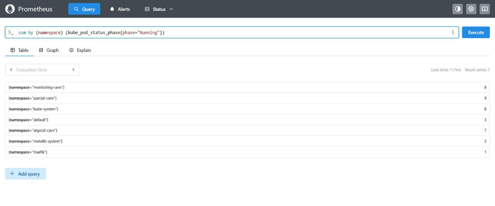

### Grafana por dominio

`http://grafana.cavv.dominio`:

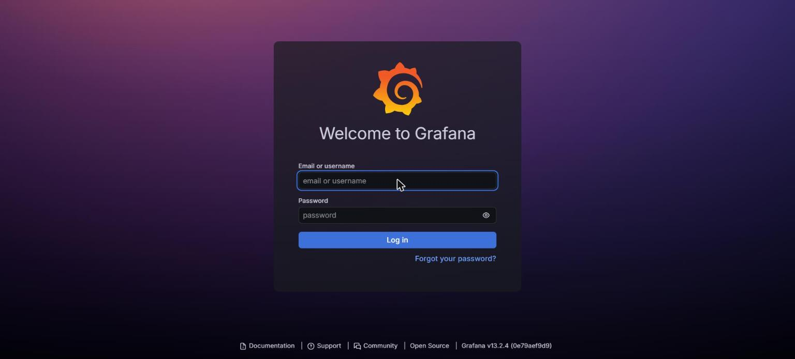

### Data sources provisionados

Prometheus y Loki, creados por provisioning:

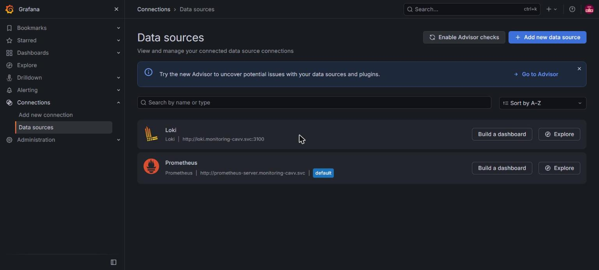

Al abrir uno, Grafana avisa que fue agregado por configuracion y no se puede editar desde la interfaz:

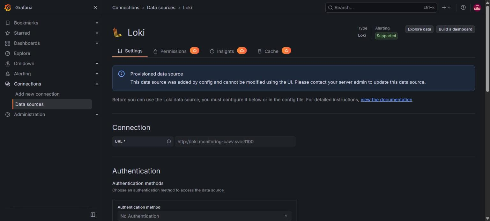

### Dashboard de metricas del cluster

Resumen del nodo y CPU/memoria por namespace:

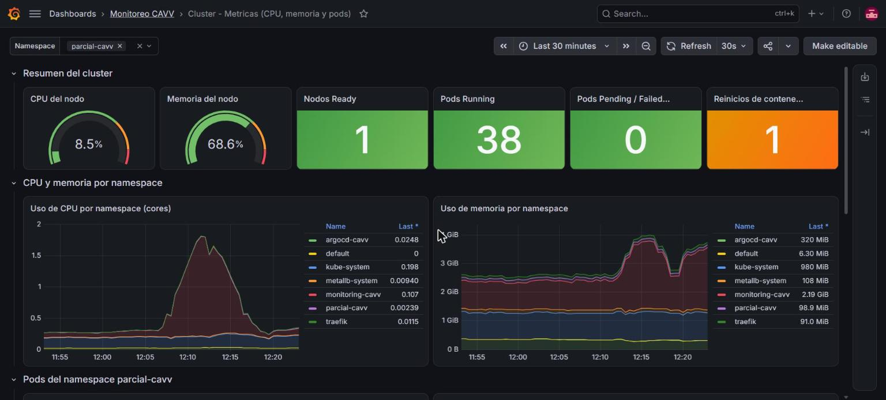

CPU/memoria por pod y estado de los pods de `parcial-cavv`:

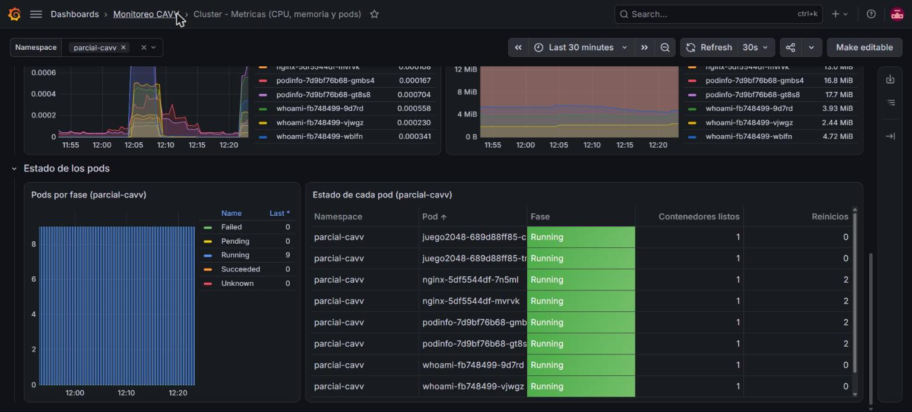

### Dashboard de logs de las 4 apps

Lineas por app y logs de nginx y whoami:

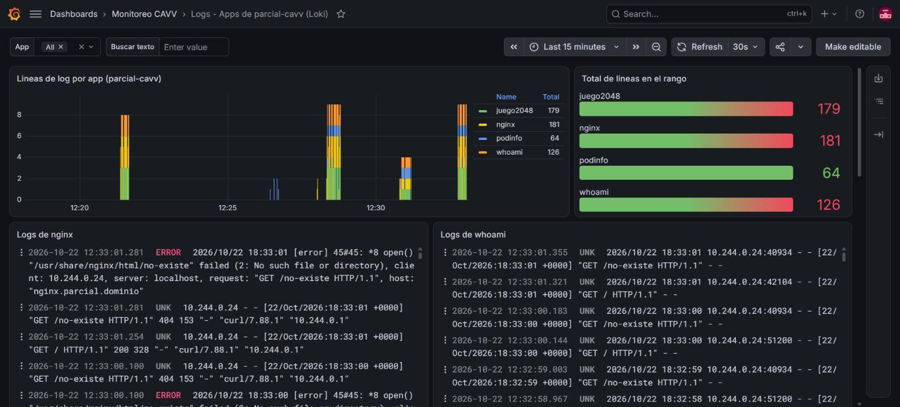

Logs de podinfo y juego2048:

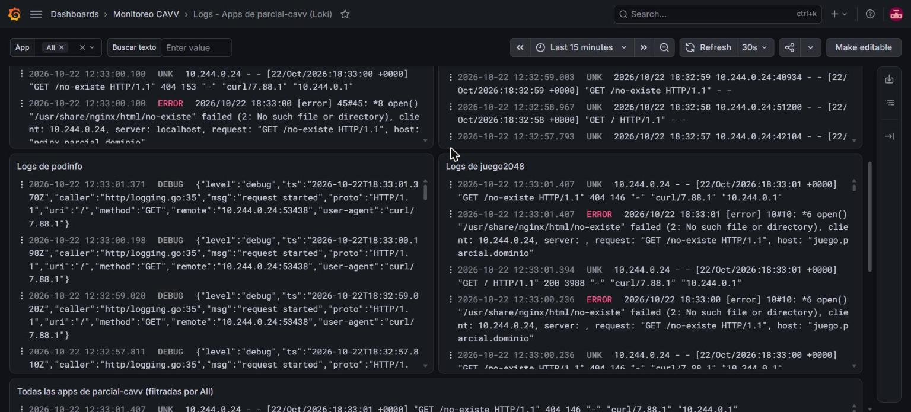

Access log de Traefik con las peticiones a cada app:

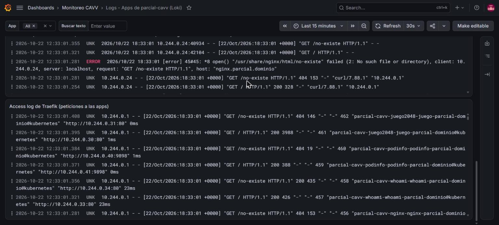

## Problemas / troubleshooting

- Targets de MetalLB DOWN con `400 Bad Request`: el endpoint es HTTPS, ver el job `metallb`. Si sale `500`, falta aplicar `metallb-metrics-rbac.yaml`.
- No salen logs de juego2048: la imagen escribe a archivos, ver el ajuste en `juego2048.yaml`.
- Grafana no responde y usa mucho CPU: con `limits.memory: 512Mi` el chart pone `GOMEMLIMIT=460MiB` y Grafana 13 se queda pegado al limite, el garbage collector de Go corre sin parar. Se subio el limite a 1Gi.
- Al reiniciar Grafana se pierde la sesion: sin `persistence` su base de datos SQLite esta en un `emptyDir`. Se le puso un PVC de 1Gi.
- Los cambios en las apps se revierten solos: Argo CD con `selfHeal`, hay que subirlos al repo (rama que sigue la Application).
- Dashboards vacios al inicio: Prometheus necesita unos minutos para tener datos de `rate(...[5m])`, y las apps solo escriben logs cuando reciben peticiones.
- Si el dominio no resuelve: revisar el archivo hosts y hacer `ipconfig /flushdns`.
