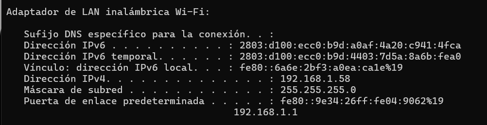
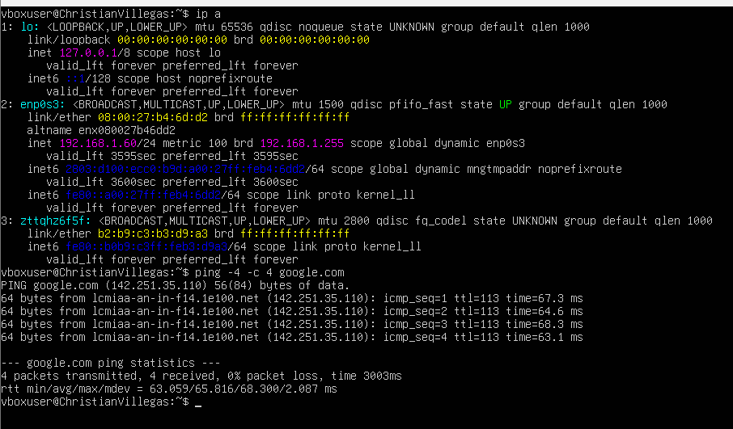
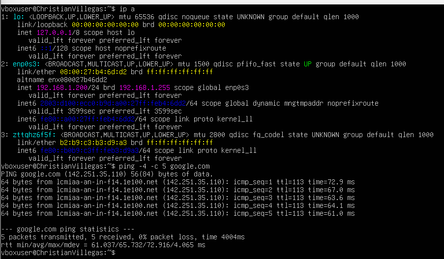
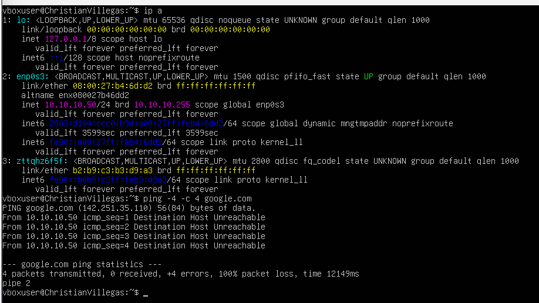

# virtualizacion-tareas
Tareas del curso de virtualizacion
# Tarea 3: Modos de Red en Maquinas Virtuales

**Hostname de la VM:** `Christian Villegas`

## Subred del Hipervisor (Host)
A continuacion se muestra la configuracion del adaptador fsiico para validar la subred asignada por el router local.

## Escenario 1: Modo Bridge (DHCP)
La maquina virtual obtuvo una IP dinamica de manera exitosa dentro del segmento de red del hipervisor.

## Escenario 2: Modo Bridge (IP Manual - Misma Subred)
Se asigno una IP estatica configurando Netplan. Al permanecer dentro del mismo segmento de red de la puerta de enlace fisica, hay salida a internet.

## Escenario 3: Modo Bridge (IP Manual - Fuera de Subred)
Se asigno una IP estatica en un segmento de red desconocido para el hipervisor. Como resultado esperado de enrutamiento, no hay salida a internet y el ping falla de manera controlada.
