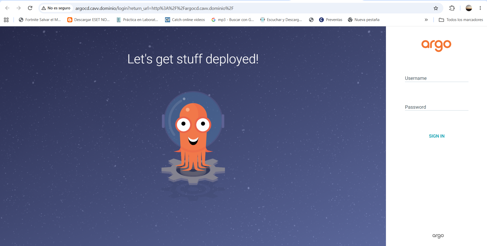
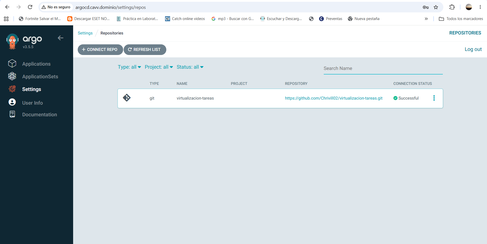
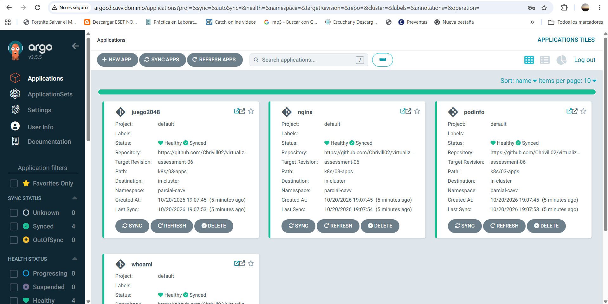
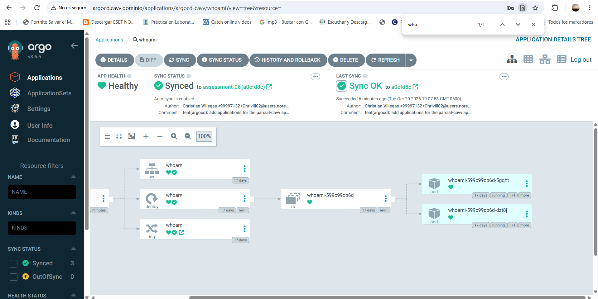
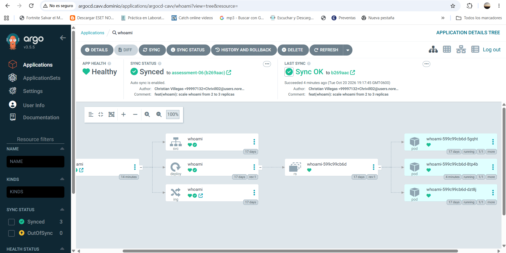

# virtualizacion-tareas
Tareas del curso de virtualizacion

## Assessment 06 - Argo CD (GitOps)

Instalar Argo CD en el cluster de Minikube de las actividades anteriores, exponerlo por Traefik con un dominio y usarlo para desplegar las apps del namespace `parcial-cavv` directamente desde este repositorio.

### Flujo

```
git push -> GitHub (rama assessment-06) -> Argo CD detecta el cambio -> aplica los YAML en el cluster
navegador -> hosts -> Traefik (LoadBalancer de MetalLB) -> Ingress argocd.cavv.dominio -> argocd-server
```

### Estructura

```
k8s/
├── 01-metallb/metallb-config.yaml        # del assessment 02
├── 02-traefik/traefik.yaml               # del assessment 02
├── 03-apps/                              # del assessment 02, ahora las despliega Argo CD
│   ├── 00-namespace.yaml
│   ├── nginx.yaml
│   ├── whoami.yaml
│   ├── podinfo.yaml
│   └── juego2048.yaml
├── 04-argocd/                            # instalacion de Argo CD
│   ├── kustomization.yaml                # manifiesto oficial + cambio de namespace
│   ├── namespace.yaml                    # argocd-cavv
│   ├── argocd-cmd-params-cm.yaml         # server.insecure (Traefik recibe el trafico)
│   ├── ingress.yaml                      # argocd.cavv.dominio
│   └── repo-github.yaml                  # conexion con el repo de GitHub
└── 05-argocd-apps/applications.yaml      # las 4 Application
capturas/
```

### Namespaces

| Namespace | Contenido |
|---|---|
| `metallb-system` | MetalLB |
| `traefik` | Traefik |
| `argocd-cavv` | Argo CD (`argocd-` + mis iniciales) |
| `parcial-cavv` | Las 4 aplicaciones |

### Requisitos

- Minikube corriendo con MetalLB y Traefik del assessment 02 (Traefik con la IP `192.168.49.200`)
- kubectl

Si se parte de un cluster vacio, primero se instala lo del assessment 02:

```bash
kubectl apply -f https://raw.githubusercontent.com/metallb/metallb/v0.16.1/config/manifests/metallb-native.yaml
kubectl wait -n metallb-system --for=condition=ready pod --all --timeout=120s
kubectl apply -f k8s/01-metallb/metallb-config.yaml
kubectl apply -f k8s/02-traefik/traefik.yaml
```

---

## 1. Instalacion de Argo CD

El manifiesto oficial de Argo CD (`install.yaml`) viene pensado para el namespace `argocd`. Para instalarlo en `argocd-cavv` use un `kustomization.yaml` que:

- Agrega el manifiesto oficial de la version **v3.5.5** como recurso.
- Con `namespace: argocd-cavv` le cambia el namespace a todos los recursos.
- Parcha los `ClusterRoleBinding`, porque kustomize no cambia el namespace de los `subjects` y se quedaban apuntando a `argocd` (Argo CD no tendria permisos en el cluster).
- Parcha el ConfigMap `argocd-cmd-params-cm` con `server.insecure: "true"`, para que `argocd-server` sirva HTTP y no intente redirigir a HTTPS (si no, con Traefik delante se hace un loop de redirecciones).
- Agrega el Ingress y la conexion con el repositorio (ver los siguientes pasos).

```bash
kubectl apply -k k8s/04-argocd --server-side
kubectl wait -n argocd-cavv --for=condition=available deploy --all --timeout=300s
kubectl get pods -n argocd-cavv
```

Se usa `--server-side` porque los CRDs de Argo CD son muy grandes para el `apply` normal.

Contrasena inicial del usuario `admin`:

```bash
kubectl -n argocd-cavv get secret argocd-initial-admin-secret -o jsonpath='{.data.password}' | base64 -d
```

## 2. Exposicion por Traefik

`k8s/04-argocd/ingress.yaml` es un Ingress con la clase `traefik` que manda todo lo que llega a `argocd.cavv.dominio` al servicio `argocd-server` (puerto `http`). Es igual que los Ingress de las apps del assessment 02.

```bash
kubectl get ingress -n argocd-cavv
# argocd-server   traefik   argocd.cavv.dominio   192.168.49.200   80
```

Prueba desde dentro del nodo contra la IP de MetalLB:

```bash
minikube ssh -- "curl -s -o /dev/null -w '%{http_code}' -H 'Host: argocd.cavv.dominio' http://192.168.49.200/"
# 200
```

### DNS local

En Linux/Mac se agrega a `/etc/hosts`:

```
192.168.49.200 argocd.cavv.dominio
```

**En mi caso (Windows + minikube con driver docker)** pasa lo mismo que en el assessment 02: Windows no llega a la red `192.168.49.0/24` de Docker, entonces hago port-forward al Service LoadBalancer de Traefik y apunto el dominio a `127.0.0.1`.

PowerShell como administrador:

```powershell
Add-Content -Path C:\Windows\System32\drivers\etc\hosts -Value "`n127.0.0.1 argocd.cavv.dominio"
ipconfig /flushdns
```

Port-forward (dejar la terminal abierta):

```bash
kubectl port-forward -n traefik svc/traefik 80:80
```

Despues se entra a `http://argocd.cavv.dominio` con el usuario `admin`.



## 3. Conexion con el repositorio

`k8s/04-argocd/repo-github.yaml` es un Secret con la etiqueta `argocd.argoproj.io/secret-type: repository`. Argo CD lee esos Secrets como repositorios registrados. Como el repo es publico solo hace falta la URL, sin usuario ni token.

Se ve en **Settings > Repositories** con estado `Successful`:



## 4. Applications

`k8s/05-argocd-apps/applications.yaml` tiene **4 Application**, una por cada app del namespace `parcial-cavv`:

| Application | Archivo que despliega |
|---|---|
| `nginx` | `k8s/03-apps/nginx.yaml` |
| `whoami` | `k8s/03-apps/whoami.yaml` |
| `podinfo` | `k8s/03-apps/podinfo.yaml` |
| `juego2048` | `k8s/03-apps/juego2048.yaml` |

Todas apuntan al repo `https://github.com/Chrivill02/virtualizacion-tareas.git`, rama `assessment-06`, carpeta `k8s/03-apps`, y con `directory.include` cada una toma solo su archivo. Configuracion importante:

- `destination`: el mismo cluster (`https://kubernetes.default.svc`), namespace `parcial-cavv`.
- `syncPolicy.automated`: Argo CD sincroniza solo cuando cambia el repo.
  - `prune: true`: si borro algo del repo, lo borra del cluster.
  - `selfHeal: true`: si alguien cambia algo a mano con kubectl, lo regresa a lo que dice el repo.
- `CreateNamespace=true`: crea `parcial-cavv` si no existe.

```bash
kubectl apply -f k8s/05-argocd-apps/applications.yaml
kubectl get applications -n argocd-cavv
# NAME        SYNC STATUS   HEALTH STATUS
# juego2048   Synced        Healthy
# nginx       Synced        Healthy
# podinfo     Synced        Healthy
# whoami      Synced        Healthy
```

Las apps ya existian en el cluster desde el assessment 02 (aplicadas con kubectl), Argo CD las "adopta" y desde ahora las maneja el.



## 5. Cambio en el repositorio

Cambie las replicas de `whoami` de **2 a 3** en `k8s/03-apps/whoami.yaml`, hice commit y push a la rama `assessment-06`. No ejecute ningun `kubectl apply`, Argo CD detecta el commit (revisa el repo cada ~3 minutos, o se puede dar click en **Refresh**) y sincroniza solo.

### Antes (2 replicas)



### Despues (3 replicas)



```bash
kubectl get deploy whoami -n parcial-cavv
# NAME     READY   UP-TO-DATE   AVAILABLE
# whoami   3/3     3            3
```

## Problemas / troubleshooting

- `ERR_TOO_MANY_REDIRECTS` en el navegador: falta `server.insecure: "true"` en `argocd-cmd-params-cm` (y reiniciar `argocd-server`).
- Las Application dicen `Unknown` o error de repo: la rama `assessment-06` no esta en GitHub todavia (hay que hacer push antes).
- Argo CD no ve el cambio: esperar unos minutos o dar **Refresh** en la Application.
- Si el dominio no resuelve: revisar el archivo hosts y hacer `ipconfig /flushdns`.
