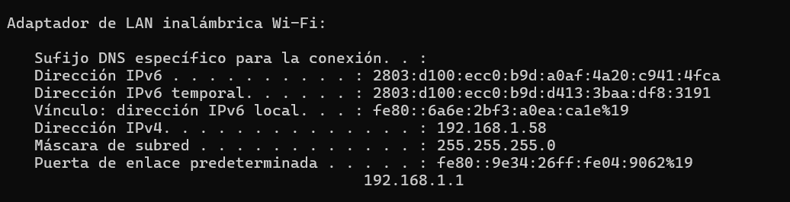
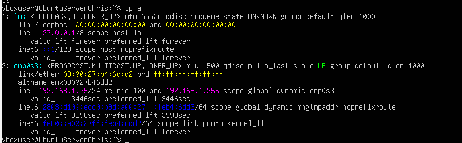
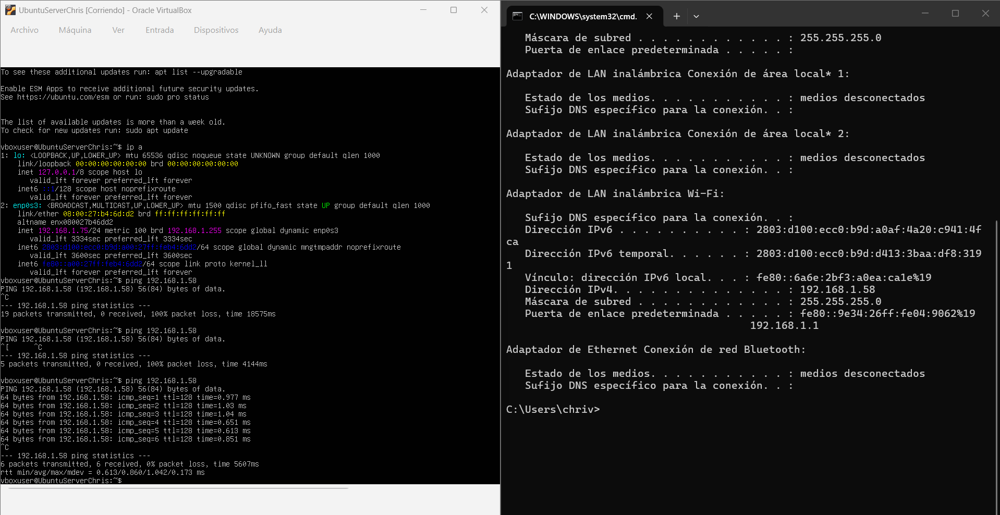

# Tarea 01 - Configuracion de Red y Comunicacion Host-Guest

**Curso:** Virtualizacion  
**Estudiante:** Christian Villegas  
**Rama:** `hw-01`  

---

## Descripcion
Configuracion del adaptador de red en modo **Adaptador Puente (Bridged Adapter)** en VirtualBox para integrar la maquina virtual de **Ubuntu Server** dentro de la misma subred del ordenador host con **Windows 11**.Se verifica la asignacion de IP y la conectividad mediante una prueba de `ping` desde el servidor virtual hacia el host

---

## Configuracion e IPs

### 1. Host Local (Windows 11)
- **Comando ejecutado:** `ipconfig`
- **Dirección IPv4:** `192.168.1.58`

---

### 2. Host Virtual (Ubuntu Server)
- **Comando ejecutado:** `ip a` 
- **Dirección IPv4:** `[Tu IP de Ubuntu, ej: 192.168.1.75]`

---

## Prueba de Conectividad (Ping)

Se realizo un `ping` desde **Ubuntu Server** hacia la direccion IP de **Windows 11**, demostrando la comunicacion bidireccional en la subred local.

- **Comando ejecutado:** `ping 192.168.1.58`

