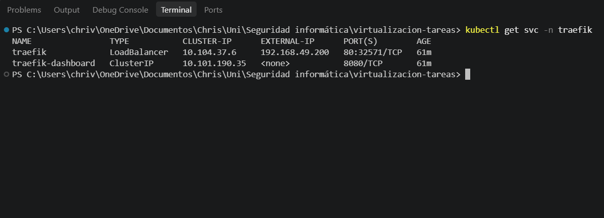
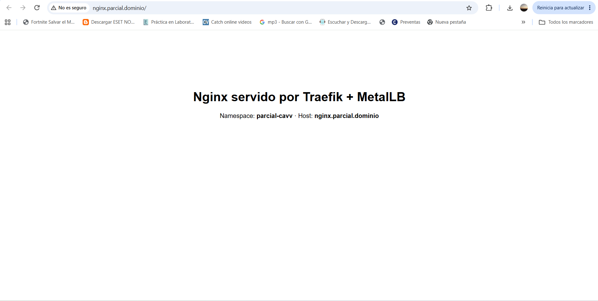
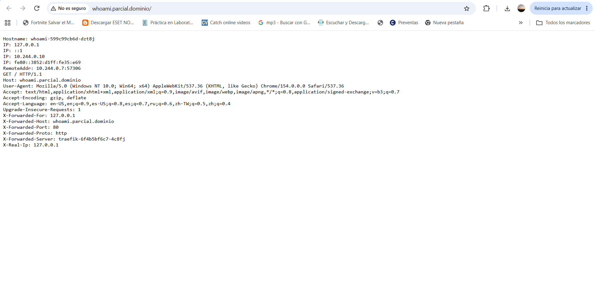
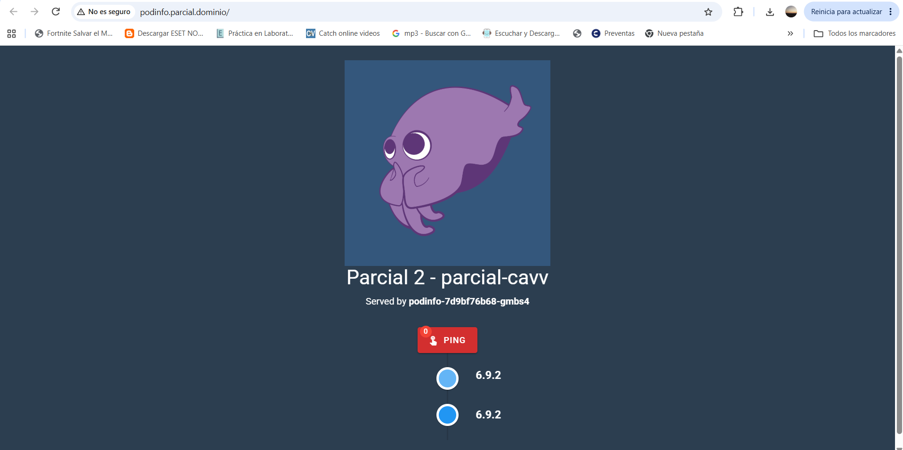
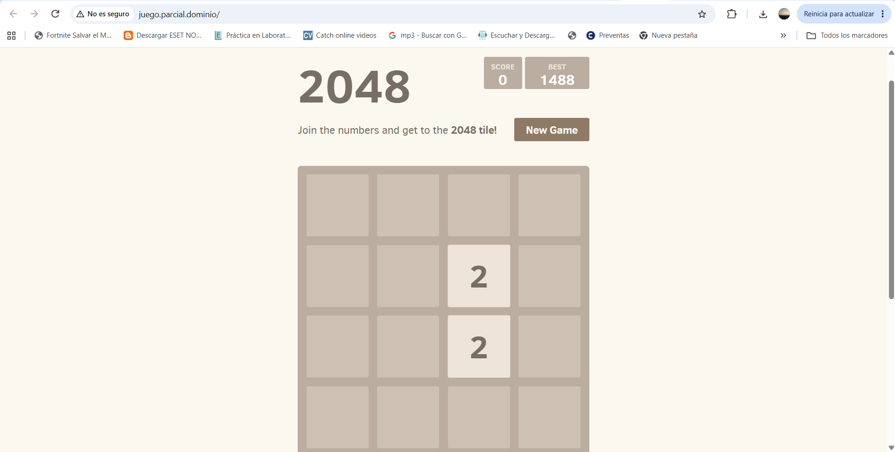

# virtualizacion-tareas
Tareas del curso de virtualizacion

## Assessment 02 - Kubernetes + Traefik + MetalLB

Exponer 4 aplicaciones web por una sola IP usando MetalLB (LoadBalancer) y Traefik (ingress controller) en Minikube.

### Flujo

```
navegador -> DNS local (hosts) -> IP del LoadBalancer (MetalLB) -> Traefik -> Ingress (por dominio) -> Service -> Pods
```

### Estructura

```
k8s/
├── 01-metallb/metallb-config.yaml   # pool con 1 IP + L2Advertisement
├── 02-traefik/traefik.yaml          # namespace, RBAC, IngressClass, deployment y service LoadBalancer
└── 03-apps/                         # namespace parcial-cavv + 4 apps
    ├── 00-namespace.yaml
    ├── nginx.yaml
    ├── whoami.yaml
    ├── podinfo.yaml
    └── juego2048.yaml
capturas/                            # evidencia en el navegador
```

### Namespaces

| Namespace | Contenido |
|---|---|
| `metallb-system` | MetalLB |
| `traefik` | Traefik |
| `parcial-cavv` | Las 4 aplicaciones (`parcial-` + mis iniciales) |

### Requisitos

- Minikube corriendo (driver docker, red `192.168.49.0/24`)
- kubectl

```bash
minikube status
minikube ip   # 192.168.49.2
```

---

## 1. Instalacion de MetalLB

Se instala con el manifiesto oficial (crea el namespace `metallb-system`, el controller, el speaker y los CRDs):

```bash
kubectl apply -f https://raw.githubusercontent.com/metallb/metallb/v0.16.1/config/manifests/metallb-native.yaml
kubectl wait -n metallb-system --for=condition=ready pod --all --timeout=120s
```

Despues se configura el pool de IPs. Solo necesitamos una IP, asi que el pool es `192.168.49.200/32`, que esta dentro de la red de minikube pero fuera del rango que usa el nodo:

```bash
kubectl apply -f k8s/01-metallb/metallb-config.yaml
```

- `IPAddressPool` (`pool-parcial`): la IP que MetalLB puede repartir.
- `L2Advertisement` (`l2-parcial`): anuncia la IP en capa 2 (ARP).

Verificar:

```bash
kubectl get ipaddresspools,l2advertisements -n metallb-system
```

## 2. Instalacion de Traefik

Todo esta en un solo archivo:

```bash
kubectl apply -f k8s/02-traefik/traefik.yaml
```

Contiene:
- **Namespace** `traefik`.
- **ServiceAccount + ClusterRole + ClusterRoleBinding**: permisos para que Traefik lea los Ingress, Services y EndpointSlices de todo el cluster.
- **IngressClass** `traefik` (default): los Ingress con `ingressClassName: traefik` los maneja Traefik.
- **Deployment** de Traefik v3 con el provider `kubernetesingress`, entrypoint `web` en el puerto 80 y dashboard en el 8080.
- **Service tipo LoadBalancer** `traefik`: con las anotaciones `metallb.io/address-pool` y `metallb.io/loadBalancerIPs` MetalLB le asigna la IP `192.168.49.200`.

Verificar que el servicio tenga la IP externa:

```bash
kubectl get svc -n traefik
```



## 3. Aplicaciones

```bash
kubectl apply -f k8s/03-apps/
```

Cada archivo tiene un **Deployment** (2 replicas), un **Service** ClusterIP y un **Ingress** que usa la clase `traefik`. Los servicios no son LoadBalancer porque no queremos una IP por app, todas entran por Traefik y Traefik decide a donde mandar segun el dominio (`host`).

| App | Imagen | Dominio |
|---|---|---|
| nginx | `nginx:1.29-alpine` (con un index.html desde un ConfigMap) | `nginx.parcial.dominio` |
| whoami | `traefik/whoami:v1.11` | `whoami.parcial.dominio` |
| podinfo | `ghcr.io/stefanprodan/podinfo:6.9.2` | `podinfo.parcial.dominio` |
| juego2048 | `public.ecr.aws/l6m2t8p7/docker-2048` | `juego.parcial.dominio` |

Verificar:

```bash
kubectl get deploy,svc,ingress -n parcial-cavv
```

Prueba desde dentro del nodo de minikube contra la IP de MetalLB:

```bash
minikube ssh -- "curl -s -o /dev/null -w '%{http_code}' -H 'Host: nginx.parcial.dominio' http://192.168.49.200/"
# 200
```

## 4. DNS local

En Linux/Mac se agregan las entradas a `/etc/hosts` apuntando a la IP del LoadBalancer:

```
192.168.49.200 nginx.parcial.dominio whoami.parcial.dominio podinfo.parcial.dominio juego.parcial.dominio
```

**En mi caso (Windows + minikube con driver docker)** la red `192.168.49.0/24` solo existe dentro de Docker Desktop, entonces Windows no puede llegar a `192.168.49.200`. Para poder entrar desde el navegador hice un port-forward al mismo servicio LoadBalancer de Traefik y apunte los dominios a `127.0.0.1`.

Archivo `C:\Windows\System32\drivers\etc\hosts` (PowerShell como administrador):

```powershell
Add-Content -Path C:\Windows\System32\drivers\etc\hosts -Value "`n127.0.0.1 nginx.parcial.dominio whoami.parcial.dominio podinfo.parcial.dominio juego.parcial.dominio"
ipconfig /flushdns
```

Port-forward (dejar la terminal abierta):

```bash
kubectl port-forward -n traefik svc/traefik 80:80
```

El trafico sigue pasando por el Service `traefik` y Traefik enruta por dominio igual que si se entrara por la IP de MetalLB.

## 5. Evidencia

### nginx.parcial.dominio


### whoami.parcial.dominio


En whoami se ve el header `X-Forwarded-Server: traefik-...`, o sea que la peticion paso por Traefik.

### podinfo.parcial.dominio


### juego.parcial.dominio


## Problemas / troubleshooting

- Si el servicio de Traefik se queda en `<pending>`: MetalLB no esta instalado o no hay pool configurado.
- Si el dominio no resuelve: revisar el archivo hosts y hacer `ipconfig /flushdns`.
- Si da 404: el `host` del Ingress no coincide con el dominio o falta `ingressClassName: traefik`.
