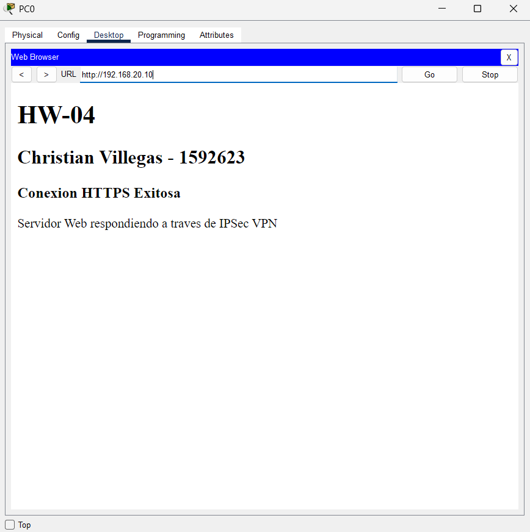

# HW-04: Conexion IPSec VPN (Tunnel Mode) con HTTPS

## Descripcion
Implementacion de un tunel VPN IPSec en modo tunel para interconectar dos sedes a traves de una red publica (Internet). Se configuro el cifrado del trafico interesante mediante listas de acceso y criptografia ISAKMP/IPSec.

## Detalles Tecnicos
* **Router Sede A (Izquierda):** IP Publica `200.10.10.1/30` | Red LAN `192.168.10.0/24`
* **Router Sede B (Derecha):** IP Publica `200.20.20.2/30` | Red LAN `192.168.20.0/24`
* **Trafico Interesante:** Permitido estrictamente entre la subred `192.168.10.0` y la `192.168.20.0`.

## Evidencia de Funcionamiento
A continuacion, se demuestra la conectividad exitosa consumiendo el servicio web seguro (HTTPS) desde la PC Cliente en la Sede A hacia el Servidor en la Sede B, forzando al trafico a viajar encriptado a traves del tunel VPN.

## La Topologia esta en la raiz del proyecto