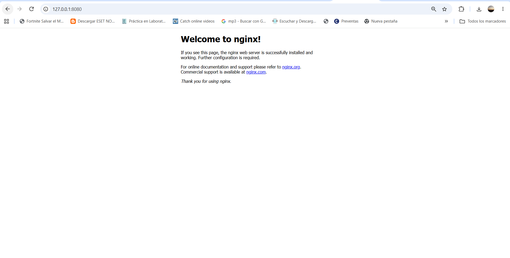

## Tarea: Despliegue de Nginx en Kubernetes (hw-05)

En esta práctica se realiza el despliegue de un servidor web Nginx utilizando Kubernetes (`minikube`).

### Arquitectura y Componentes
- **Service:** Se configuró un servicio de tipo `ClusterIP` para agrupar las réplicas y exponer el tráfico interno por el puerto 80.

### Evidencia de Ejecución
A continuación, se adjunta la captura de pantalla comprobando el acceso al servicio Nginx desde el navegador (utilizando un `port-forward` al puerto 8080):

